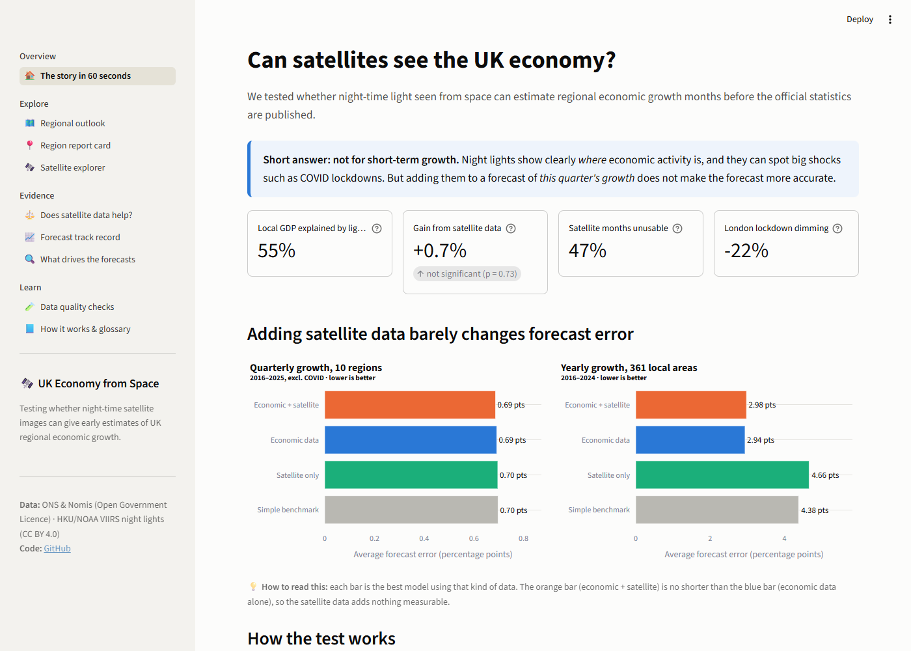
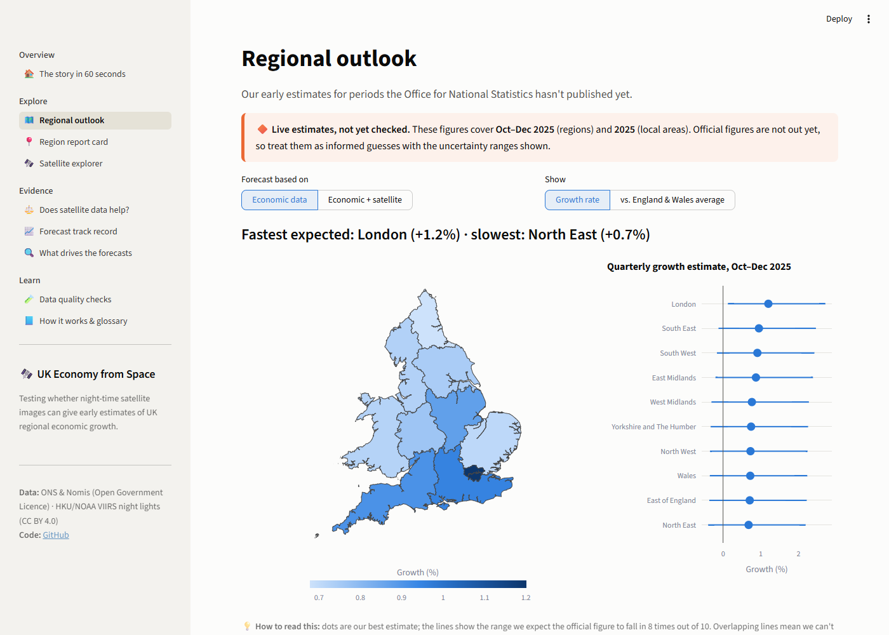
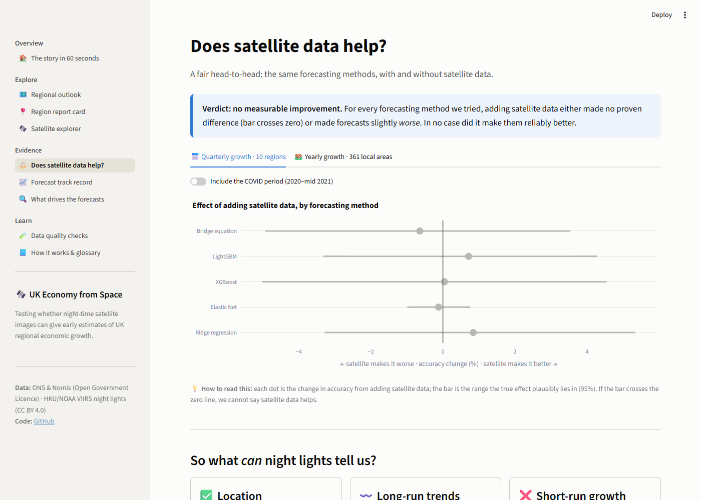

# 🛰️ Can Satellites See the UK Economy?

**Testing whether night-time satellite images can estimate UK regional economic growth months
before official statistics are published.**



## The answer in 30 seconds

| | |
|---|---|
| ✅ **Lights show *where* the economy is** | Brightness explains **55%** of the differences in economic size between 361 local areas. |
| ✅ **Lights can spot big shocks** | Central London went **22% darker** than the rest of the country during the 2021 lockdown. |
| ❌ **Lights do *not* help forecast short-term growth** | Adding satellite data changed forecast accuracy by **+0.7%**, which is not statistically significant. In some cases it made forecasts worse. |
| ⚠️ **Half the satellite record isn't real data for the UK** | UK summer nights are too short to observe. The source fills those months with copies of December, so the pipeline detects and removes them. |

**Why it matters:** this is a rigorous test of an *alternative data* source, the kind hedge funds
and central banks evaluate. Every forecast uses only information that was public at the time,
and the results are checked for statistical significance. A well-evidenced "no" is a real research result.

## Try the dashboard

```bash
git clone https://github.com/manichitumala/uk-economy-space-nowcasting.git
cd uk-economy-space-nowcasting
python -m venv .venv && .venv\Scripts\activate        # macOS/Linux: source .venv/bin/activate
pip install -r requirements.txt
streamlit run dashboard/app.py
```

It works immediately from the processed data included in the repo. No accounts or API keys are needed.

| Page | What you'll see |
|---|---|
| 🏠 **The story in 60 seconds** | The key findings, one chart, and how the test works |
| 🗺️ **Regional outlook** | Live estimates for Oct–Dec 2025 (not yet published by ONS) on an interactive map, with uncertainty ranges and CSV download |
| 📍 **Region report card** | One page per region: latest estimate, track record and night-light trend, with an auto-written plain-English summary |
| 🛰️ **Satellite explorer** | Browse 165 months of night-light maps for regions or local areas, with data-quality warnings |
| ⚖️ **Does satellite data help?** | The head-to-head verdict, shown as a simple "does the bar cross zero?" chart |
| 📈 **Forecast track record** | How each approach would have performed since 2016, by region and over time |
| 🔍 **What drives the forecasts** | Which inputs the models use (SHAP), plus the COVID lockdown case study |
| 🧪 **Data quality checks** | The summer-copy problem and how much official figures get revised |
| 📘 **How it works & glossary** | The method step by step and a searchable glossary of every term |

<p float="left">
  
  
</p>

## How it works

1. **Collect:** 165 monthly night-light images of the UK (2012–2025, ~500 m pixels), ONS regional
   GDP, UK monthly GDP and benefit-claimant counts.
2. **Clean:** detect summer months that are copies of December, dampen cloud noise, and measure
   true pixel areas.
3. **Measure:** brightness, lit-up area and light concentration for 10 regions and 361 local
   authorities, every month.
4. **Replay history fairly:** for every quarter since 2016, forecast using only data public about
   five weeks after the quarter ended.
5. **Compare:** run identical methods with and without satellite data (Ridge, Elastic Net,
   XGBoost, LightGBM, a bridge equation and simple benchmarks), then test the difference statistically.

## Read more

* 📄 **[Full research report](reports/research_report.md)**: starts with a plain-English summary.
* 📊 [Model evaluation tables](reports/model_evaluation.md) · 🔎 [Data audit](docs/data_availability_audit.md) ·
  🧪 [Forecasting protocol](docs/forecasting_protocol.md) · 🗂️ [Data sources](docs/data_sources.md)

<details>
<summary><b>For developers: project structure, pipeline and tests</b></summary>

```
src/ingestion/      satellite.py (stream & crop rasters) · ons.py (ONS, Nomis) · boundaries.py
src/processing/     quality_checks.py (December-copy detector) · raster_processing.py ·
                    regional_aggregation.py · economic.py (targets with release dates & vintages)
src/features/       build_features.py: point-in-time features (no look-ahead)
src/models/         baselines.py · train.py (walk-forward, conformal intervals) · evaluate.py
                    (Diebold–Mariano, block bootstrap) · analysis.py · predict.py
src/utils/          config.py · labels.py (plain-English names shared by report and dashboard)
dashboard/          app.py (navigation) · common.py · views/ (9 pages)
tests/              20 tests incl. leakage tests that corrupt all post-forecast-date data
```

```bash
pytest                                   # unit, leakage and data-quality tests
python run_pipeline.py                   # full rebuild (~15–30 min, streams ~28 GB of rasters)
python run_pipeline.py --from features   # rebuild from cached aggregates (~2 min)
docker build -t uk-space-nowcast . && docker run -p 8501:8501 uk-space-nowcast
```

**Stack:** Python 3.11 · rasterio · GeoPandas · pandas · DuckDB/Parquet · scikit-learn · XGBoost ·
LightGBM · statsmodels · SHAP · Plotly · Streamlit · pytest · GitHub Actions · Docker.
</details>

## Limitations

* Quarterly regional GDP exists in **one published version** (ONS, July 2026), so past forecasts use
  today's figures for earlier quarters, restricted to what would have been published at the time.
* The open satellite product has no cloud-coverage information. A NASA Black Marble version needs a
  free NASA Earthdata account and is the main next step.
* With about 10 years of quarterly data, gains smaller than about 5% can't be detected.

## Credits

Night lights: Cheng, Geng, Li et al. (2026), *Earth System Science Data* 18, 3449–3479,
[doi:10.25442/hku.31321315](https://doi.org/10.25442/hku.31321315), CC BY 4.0. Economic data:
Office for National Statistics and Nomis, Open Government Licence v3.0. Code: MIT.
