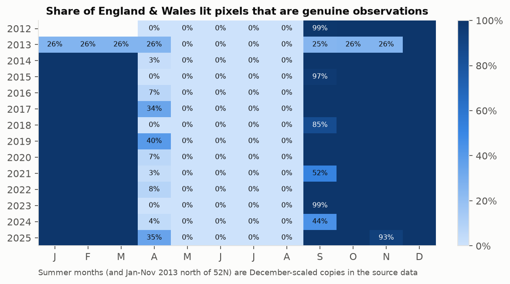
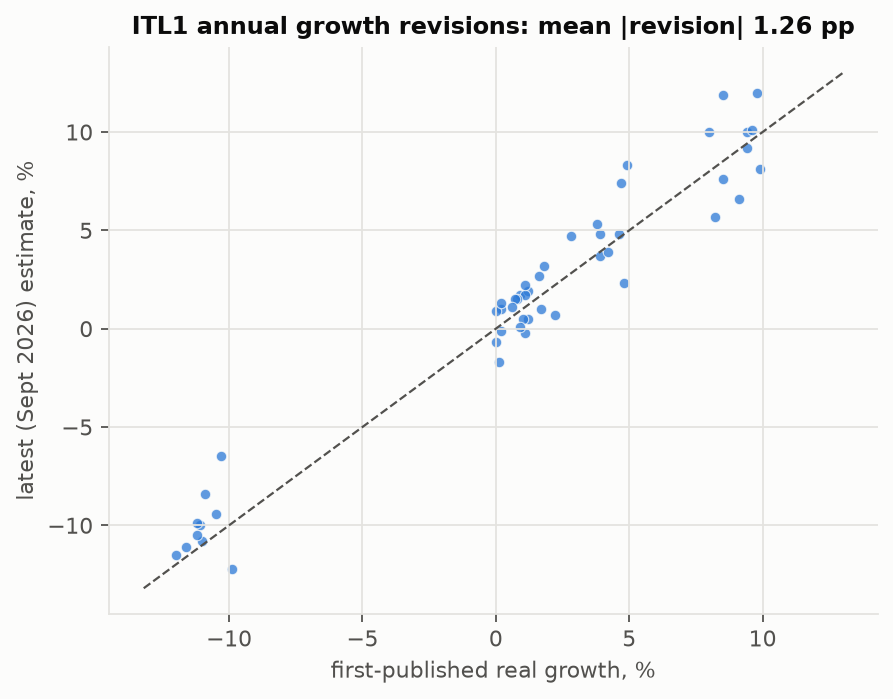
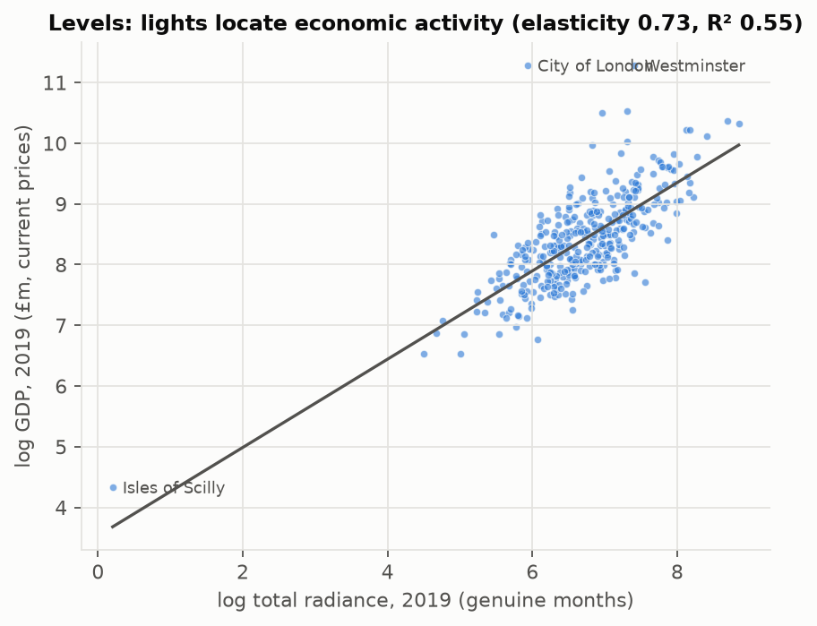
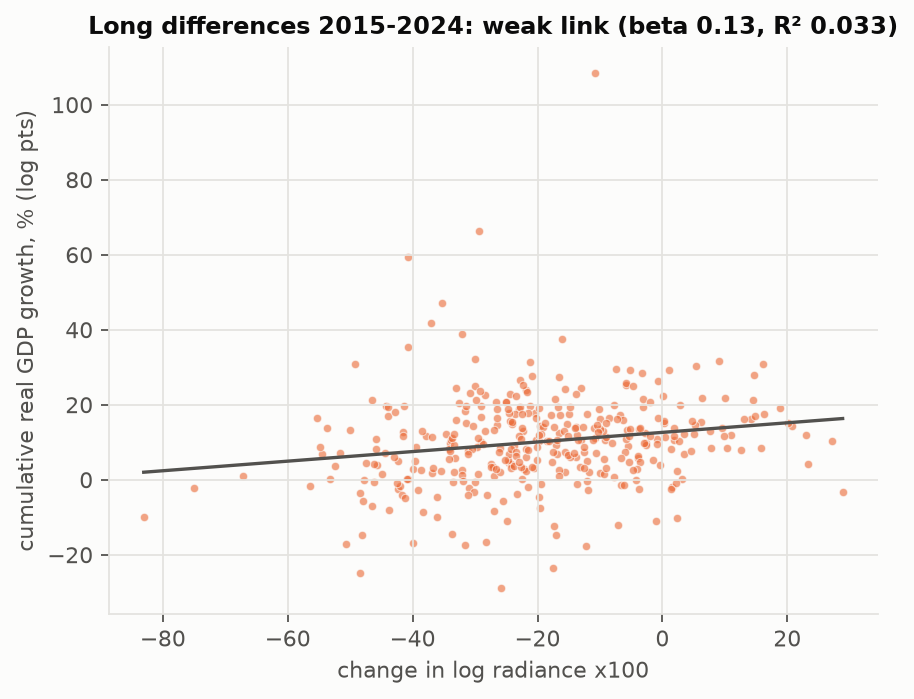
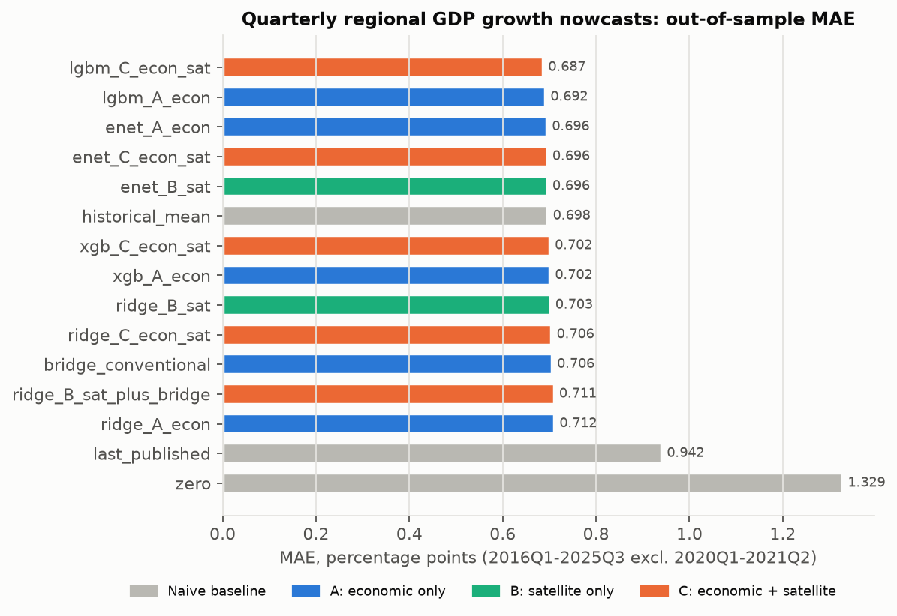
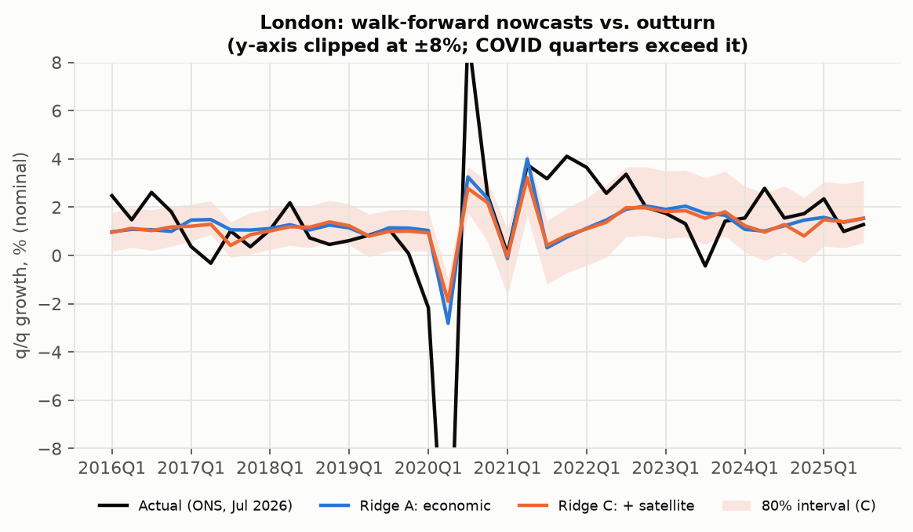
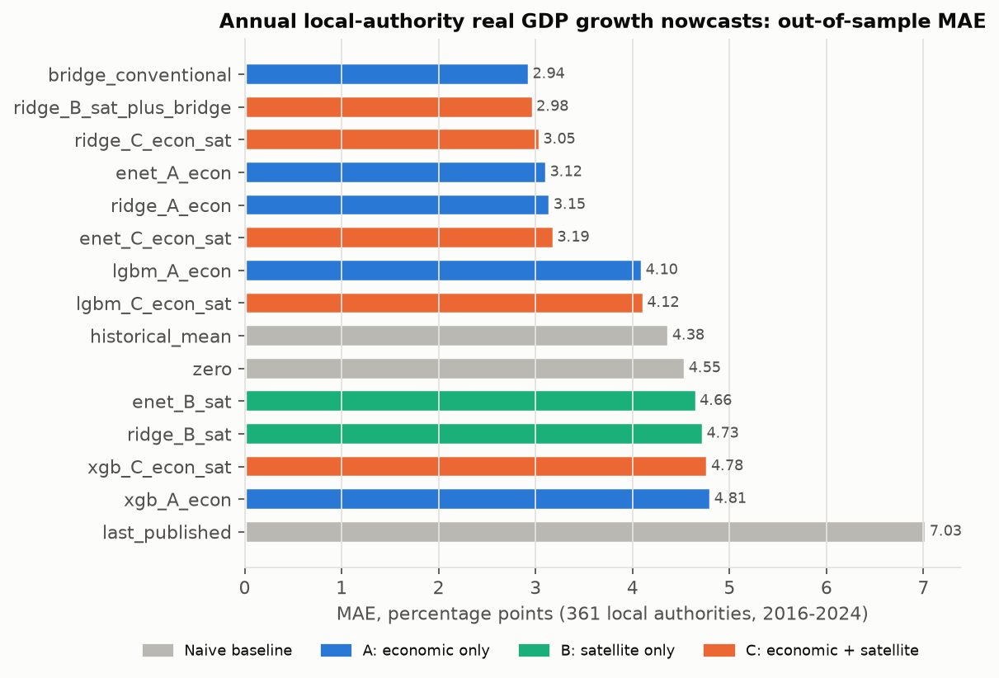
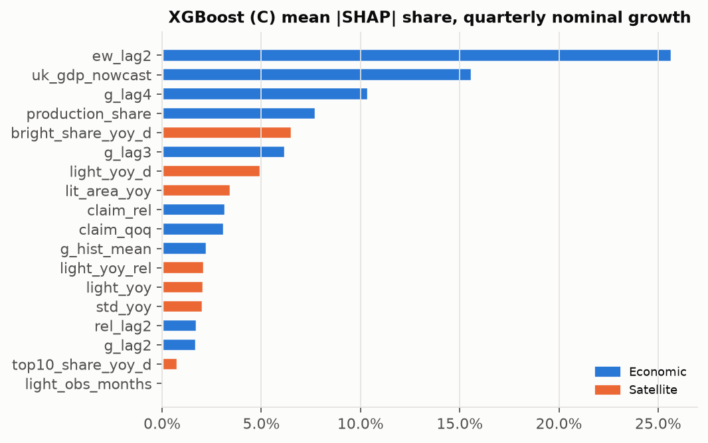
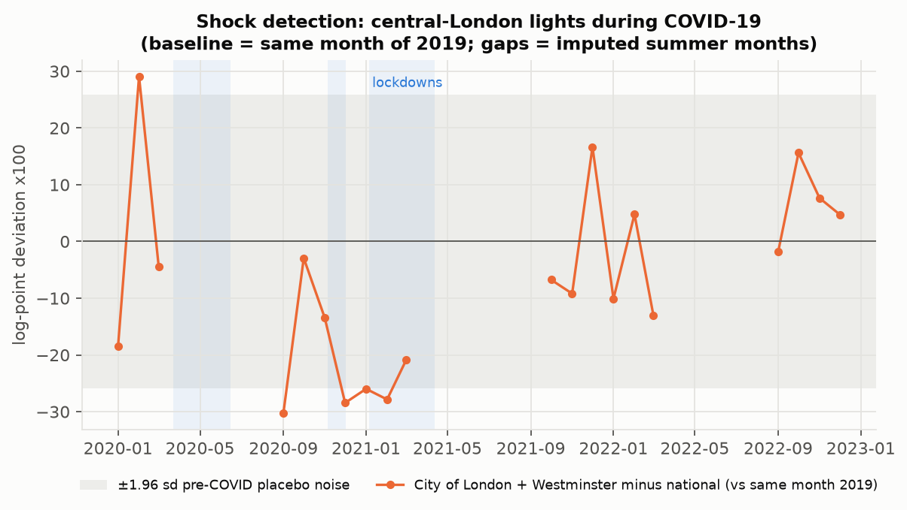

# Nowcasting the UK Economy from Space

### Do satellite night-time lights improve point-in-time nowcasts of UK regional GDP?

*Technical research report · November 2026 · code and data: this repository*

---

## Abstract

I build a reproducible pipeline that converts 165 months (April 2012 to December 2025) of
VIIRS night-time light rasters into point-in-time features for the nine English ITL1 regions,
Wales and 361 local authorities. I then test whether those features improve nowcasts of regional
GDP beyond conventional, already-published indicators. Two tracks are evaluated with
expanding-window, release-date-aware backtests. Track B nowcasts quarterly regional GDP growth
from ONS's July 2026 indicative series. Track A nowcasts annual local-authority real GDP growth.

The data audit finds that **47% of monthly composites are not observations at all**. At UK
latitudes, May to August (and most of April) are filled in the source data with a scaled copy of
the *same year's December*. Used naively, that would leak information from up to eight months in
the future. After masking these months, satellite features add **no statistically significant
accuracy** in either track or any model family. The best satellite-enhanced quarterly model
improves MAE by 0.7% (95% CI −3.3% to +4.3%, Diebold–Mariano p = 0.73). An apparent 3.3% gain in
the annual track comes entirely from one small-sample year.

Lights do carry economic information at other horizons. They locate activity in levels: the
cross-sectional elasticity of LA GDP to radiance is 0.73, R² = 0.55. They weakly track ten-year
divergence: long-difference t = 3.8, R² = 0.03. They detect large localised shocks: central
London fell 25 log points relative to the national trend in the Jan–Mar 2021 lockdown (z ≈ −3.3).
**For UK short-run growth they are not a useful nowcasting signal.** This report documents why.

---

## 1. Motivation and question

Official regional output statistics are slow. ONS annual regional and local-authority GDP arrives
about 21 months after the reference year. Quarterly regional GDP was paused in July 2023 and only
reappeared, as an *indicative* current-price series, on 31 July 2026. Night-time radiance from
VIIRS is available within weeks, at about 500 m resolution, for every part of the country. The
question is therefore practical:

> At the moment a nowcast would actually be made, do night-time lights add predictive
> information about UK regional economic activity beyond conventional indicators?

The question is deliberately incremental. A strong correlation between two trending *level*
series does not show nowcasting value. Neither does in-sample fit, or a model that silently uses
data published after the forecast date.

## 2. Data

| Source | Use | Detail |
|---|---|---|
| HKU monthly VIIRS-like NTL v4 (Cheng et al., 2026; CC BY 4.0) | Satellite | 15″ grid, built from EOG monthly composites; cropped to UK, 165 months |
| ONS quarterly regional GDP, E&W (31 Jul 2026, indicative) | Track B target | ITL1, current prices, SA, Q1 2012–Q3 2025 |
| ONS regional GDP, all ITL (six vintages, 2019–2024 editions) | Revisions | Annual CVM growth |
| ONS regional GDP, local authorities (1998–2024 edition) | Track A target | 361 LADs, CVM and CP |
| ONS monthly GDP (ECY2) | Conventional | UK, CVM SA |
| Claimant count (Nomis NM_162_1) | Conventional | ITL1 regions and 361 LADs, monthly |
| ONS Open Geography (ITL1 2021, LAD Dec 2024) | Zonal statistics | BGC boundaries |

NASA Black Marble (VNP46A2/A3), EOG composites and Google Earth Engine all require authenticated
accounts. The HKU product is open and built on the same EOG monthly composites, so the pipeline
runs end to end without credentials. The extraction module is source-agnostic.
Full details: [`docs/data_sources.md`](../docs/data_sources.md).

## 3. Data audit: three findings that shape everything else

### 3.1 Half of the satellite record is synthetic and forward-looking

For each month I compare every pixel with the same year's December. Where a large share of lit
pixels sit at one exact ratio, the month is a scaled copy rather than an observation. This is the
documented gap-filling rule of the HKU product, applied wherever EOG had no usable data.



* May to August are 0% genuine in every year; April is 0–40% genuine. The cause is twilight
  during short UK summer nights.
* January to November 2013 north of about 52°N is also synthetic.
* Only **88 of 165 months** are usable for England & Wales. Mean genuine months per quarter:
  **Q1 2.6, Q2 0.0, Q3 0.7, Q4 2.8.**
* These synthetic pixels are *leaky*. A June value equal to 0.87 × December contains December's
  information. Any Q2 or Q3 nowcast using it would see the future. The pipeline therefore masks
  every month with a genuine share below 50%, and `tests/test_data_quality.py` asserts that the
  summer months are flagged.

### 3.2 Residual cloud contamination is large

The HKU product does not ship EOG's cloud-free-coverage band. Genuine months still contain large
non-economic swings. London radiance fell about 45% in November–December 2024, during the
persistent "anticyclonic gloom", then recovered in January. Because of 3.1, the depressed
December 2024 field was also copied into summer 2024. Monthly year-on-year changes are therefore
winsorised at ±30 log points. A pre-COVID placebo puts the noise of a monthly central-London
contrast at a standard deviation of 13 log points.

### 3.3 The targets are revised heavily and are partly interpolated

ITL1 annual real growth was revised by an average of **1.26 pp** (maximum 3.8 pp, five sign
changes in 50 region-years) between first publication and the September 2026 edition. London's
2019 growth went from 2.2% to 0.7%. Typical growth is only 1–3%.

The quarterly series takes its regional *shares* from the annual accounts and constrains them to
national quarterly totals, so within-year regional dynamics are smooth by construction. Only one
vintage of the new quarterly methodology exists. Lagged-GDP features are therefore pseudo-real-time:
they use the final vintage, but only for quarters that would have been published by the origin.



## 4. Methodology

### 4.1 Satellite processing

Each global raster (86,401 × 33,601 pixels) is streamed and cropped to the UK. Regions and LADs
are rasterised onto the grid (pixel-centre rule), and every aggregate uses exact spherical pixel
area. Pixel area shrinks by about 22% between 50°N and 60°N. For each zone and month the pipeline
computes:

* total and mean radiance;
* median and spatial standard deviation;
* lit area (> 0.5 nW cm⁻² sr⁻¹);
* bright-pixel share (> 20);
* the share of radiance emitted by the brightest 10% of pixels;
* the genuine-observation share.

### 4.2 Point-in-time features

Each source has an availability date. Annual regional GDP uses the actual ONS release dates
(26 May 2021 … 23 Sep 2026). The other sources use documented lags: quarterly regional GDP +130
days, UK monthly GDP +42, claimant count +18, lights +30. Features are computed only from data
available at the origin:

* **Track B:** origin is quarter end + 35 days. The latest known regional GDP is t-2.
* **Track A:** origin is year end + 35 days. The latest known LA GDP is Y-2.

Satellite features are year-on-year log changes averaged over genuine months only, which also
removes seasonality. The full list is in [`docs/forecasting_protocol.md`](../docs/forecasting_protocol.md).

**Leakage test.** `tests/test_no_leakage.py` corrupts every value published after an origin and
asserts that the features at that origin are bit-identical.

### 4.3 Models and experiment

* **Baselines:** zero, historical mean, last published value.
* **Conventional bridge equation (OLS):** UK monthly GDP plus claimant count.
* **Learners:** Ridge (RidgeCV), Elastic Net (time-series CV), and shallow, heavily regularised
  XGBoost and LightGBM with Huber-type losses.
* **Feature sets:** each learner is run on **A** (economic), **B** (satellite) and **C** (both),
  plus *bridge + satellite*.

### 4.4 Evaluation

The backtest is expanding-window walk-forward and trains only on targets published by the origin
(≤ P-2). Track B tests 2016Q1–2025Q3 (390 region-quarters). Track A tests 2016–2024 (3,249
LA-years). Metrics are:

* MAE and RMSE, in percentage points;
* directional accuracy for relative targets;
* split-conformal 80% intervals built from past out-of-sample errors, with their coverage.

Forecasts are compared with Diebold–Mariano tests (HLN correction) on period-average losses and a
period-block bootstrap of the relative MAE gain. Results are shown with and without COVID
(2020Q1–2021Q2), which is excluded from Track B *training*.

## 5. Results

### 5.1 Where lights *do* carry economic information

| Horizon | Specification | Estimate | Fit |
|---|---|---|---|
| Levels | log GDP on log radiance, 361 LAs, 2019 | elasticity **0.73** (s.e. 0.035) | R² **0.55** (0.50–0.56 across 2014–2024) |
| Long run | 2015→2024 cumulative real growth on Δlog radiance | β = 0.13, **t = 3.8** | R² 0.03, Spearman 0.22 |
| Long run | 2014→2019 | β = 0.09, t = 3.2 | R² 0.02 |
| Annual growth | two-way FE (LA + year), 2015–2024, clustered by LA | β = −0.001, **t = −0.07** | within-R² ≈ 0.000 |
| Annual growth, ex-COVID | two-way FE | β = −0.020, t = −1.87 (wrong sign) | within-R² 0.001 |
| Annual growth, urban top quartile / rest | two-way FE | t = −0.26 / +0.20 | ≈ 0 |

 

Lights locate economic activity, which is the well-known levels result. They are weakly related to
decade-long divergence. They show **no relationship with year-to-year growth** once the common
national shock is removed. The national average is not informative either: the
cross-LA mean of light growth fell 2.1% in 2020, when real GDP fell 10.9%, and fell 5.0% in 2024,
when GDP rose 1.3%.

### 5.2 Track B: quarterly regional nowcasts

**Nominal growth, excluding COVID quarters (330 region-quarters):**

| Model | Set | MAE (pp) | RMSE | 80% PI coverage |
|---|---|---|---|---|
| LightGBM | C econ + sat | **0.687** | 0.879 | 81% |
| LightGBM | A econ | 0.692 | 0.887 | 81% |
| Elastic Net | A / C / B | 0.696 | 0.90 | 82% |
| Historical mean | baseline | 0.698 | 0.899 | 83% |
| XGBoost | A / C | 0.702 | 0.89 | 78–80% |
| Ridge | C | 0.706 | 0.909 | 78% |
| Bridge (UK GDP + claimants) | A | 0.706 | 0.912 | 77% |
| Ridge | A | 0.712 | 0.929 | 77% |
| Last published (t-2) | baseline | 0.942 | 1.213 | 86% |
| Zero | baseline | 1.329 | 1.550 | 82% |



**Paired tests, C vs A** (33 quarters as blocks):

| Family | MAE gain of C | 95% bootstrap CI | DM p (abs) | DM p (sq) |
|---|---|---|---|---|
| Ridge | +0.8% | −3.3% to +5.3% | 0.73 | 0.48 |
| Elastic Net | −0.1% | −1.0% to +0.8% | 0.79 | 0.89 |
| XGBoost | +0.0% | −5.0% to +4.5% | 0.99 | 0.95 |
| LightGBM | +0.7% | −3.3% to +4.3% | 0.73 | 0.62 |
| Bridge + satellite vs bridge | −0.6% | −4.9% to +3.5% | 0.77 | 0.52 |

Including the COVID quarters, economic indicators do help. Ridge-A beats the historical mean by
15.8% (CI +1.8% to +26.0%, DM p = 0.07), because UK monthly GDP captures the 2020 collapse.
Satellite features **hurt** in that sample: bridge + satellite is 17.5% worse than the bridge
alone (CI −26% to −3%). The COVID collapse falls in the imputed Q2 window, so the lights
cannot see it.

**Relative growth** (region minus England & Wales) is essentially unpredictable. Every linear
model and baseline lands at MAE 0.498–0.503 pp with directional accuracy of about 53%, a coin
flip. Gradient boosting is slightly worse at 0.53. This is consistent with §3.3: the regional
*deviations* in the quarterly series largely come from annual benchmarking that no indicator
available at the origin can see.

Gains are no better in Q1 and Q4, the quarters with three genuine satellite months. The Ridge
C-vs-A MAE is 0.726 vs 0.711 in Q1 and 0.761 vs 0.760 in Q4. Region by region, no region
consistently benefits.



### 5.3 Track A: annual local-authority nowcasts (3,249 LA-years)

| Model | Set | MAE (pp) | RMSE | 80% PI coverage |
|---|---|---|---|---|
| Bridge (UK GDP + claimants) | A | **2.94** | 4.30 | 76% |
| Ridge, bridge + satellite | C | 2.98 | 4.32 | 75% |
| Ridge | C | 3.05 | 4.42 | 74% |
| Elastic Net | A | 3.12 | 4.53 | 74% |
| Ridge | A | 3.15 | 4.54 | 71% |
| Historical mean | baseline | 4.38 | 6.49 | 65% |
| Ridge | B satellite only | 4.73 | 6.68 | 57% |
| Last published (Y-2) | baseline | 7.03 | 9.63 | 58% |



The best model is the conventional bridge equation. Adding satellite features to it makes it
1.3% *worse* (CI −2.7% to −0.2%). Satellite features alone are worse than the historical mean.

Ridge-C does beat Ridge-A by 3.3%, and an LA-resampling bootstrap would call that significant
(CI +2.6% to +4.1%). The year-block bootstrap (CI −1.7% to +11.5%) and DM test (p = 0.44) do
not. Decomposing by year shows that **the entire gain comes from 2016**. In that first test year
Ridge-A had only two training years and a +3.3 pp bias that the satellite features happened to
offset. After removing each year's common bias, the cross-sectional MAEs are 2.822 (A) and 2.826
(C). The relative-growth target confirms the null: all models fall between 2.80 and 2.84 pp.

This illustrates why panel forecast comparisons must respect common time shocks.

### 5.4 Uncertainty

The conformal 80% intervals are well calibrated in normal times: Track B ex-COVID coverage is
77–83%. They under-cover during shocks, at 69–73% including COVID. Interval width is about
2.2–2.4 pp for quarterly growth and about 9 pp for annual LA growth. That is honest
uncertainty for small, noisy regional aggregates.

### 5.5 Explainability

In the XGBoost-C model, satellite features account for **22% of mean |SHAP|**. The dominant
features are lagged England & Wales growth (26%) and the UK monthly-GDP nowcast (16%). The Ridge-C
model (α = 56) assigns small positive weights to the bright-share and top-10% concentration changes.

Neither model gains accuracy from these features out of sample. The models use the satellite
inputs to fit noise. SHAP describes the fitted function. It is not evidence of predictive value
or of causation.



### 5.6 Extension: shock detection

The event study compares City of London + Westminster with all of England & Wales, each relative
to the same month of 2019.



* Jan–Mar 2021 lockdown: **−24.9 log points** (pre-COVID placebo s.d. 13.2; z ≈ −3.3).
* Sep–Dec 2021: +0.2 log points (recovered). Sep 2019–Feb 2020: +1.8.
* The first lockdown (April–June 2020) cannot be observed: it falls inside the imputed window.

Lights can detect a large, sustained, spatially concentrated shock: office districts going dark.
Detection takes about a quarter of data to rise above noise and fails entirely in summer.

### 5.7 Live nowcast (not yet verifiable)

The pipeline produces a genuine out-of-sample nowcast for 2025 Q4, from the 4 Feb 2026 origin.
ONS had not published Q4 regional estimates as of November 2026. Selected Ridge-C nominal q/q
growth (80% PI):

* London: 1.71% (0.69 to 3.23)
* South East: 1.07% (0.05 to 2.60)
* North East: 0.61% (−0.41 to 2.14)

Ridge-A gives London 1.20%. Annual 2025 LA nowcasts are also produced; ONS is due to publish
these around September 2027. Both appear in the dashboard, labelled as live, separately from the
backtests.

## 6. Why does the signal fail for the UK?

1. **No summer data.** Q2 has no genuine observations and Q3 has one month, at exactly the
   latitudes that matter.
2. **The noise is larger than the signal.** Monthly cloud, snow and atmospheric noise are tens of
   percent, while the target varies by tenths of a percent.
3. **Lighting is decoupled from output.** UK output is dominated by services. LED retrofits lower
   the VIIRS-measured radiance, because the Day/Night Band is blind below about 500 nm, and
   council dimming policies (notably during the 2022–23 energy crisis) move radiance
   independently of output. Lights *fell* in 2016, 2017, 2019 and 2024, all growth years.
4. **The targets are partly built from annual benchmarks.** Quarterly regional deviations are not
   observed in real time by anyone, so no early indicator can track them.

These are features of the UK problem, not of the code. The same pipeline would be more promising
in low-latitude, less-electrified economies, which is where the literature finds value.

## 7. Limitations

* **Pseudo-real-time GDP.** Lagged-GDP features use the final vintage because only one vintage of
  the quarterly methodology exists. Real-time vintages would add revision noise to the economic
  features and could slightly favour satellite data. The annual vintages show revisions of
  1.26 pp.
* **Satellite product.** No cloud-free-count band is available, and the gap-filling is
  December-based. A NASA Black Marble VNP46A3 run with Earthdata credentials (it has quality
  flags and BRDF/lunar correction) is the main robustness check still outstanding.
* **Release lags are assumptions** for the quarterly series, monthly GDP, claimants and lights.
  The annual release dates are the actual ones.
* **Nominal quarterly target.** No regional deflators exist; the relative-growth target addresses this.
* **Small samples.** The tests have 33–39 quarterly blocks and 9 annual blocks, so modest gains
  (around 3%) could not be detected. The CIs bound plausible gains at roughly ≤ 5%.
* **Hyperparameters** are fixed and conservative rather than tuned per window. With these sample
  sizes, tuning risks overfitting the backtest.

## 8. Conclusion

| Hypothesis | Verdict |
|---|---|
| H1: lights locate activity (levels) | **Supported:** elasticity 0.73, R² 0.55 |
| H2: lights track long-run divergence | **Weakly supported:** t ≈ 3–4, R² 0.02–0.03 |
| H3: lights track annual growth | **Not supported:** within-R² ≈ 0 |
| H4: lights improve point-in-time nowcasts | **Not supported** in either track, any model family; gains bounded at about ≤ 5% |
| H5: lights detect large local shocks | **Supported with caveats:** −25 log points, z ≈ −3.3; blind in summer |

For a quantitative or economic-research audience, the transferable lessons are about method:

* audit how alternative data was *produced* before modelling it;
* enforce point-in-time integrity in code and test it;
* compare against strong conventional baselines;
* respect common shocks when testing panel forecasts.

A null result reached this way answers the research question.

## 9. Reproducibility

```bash
pip install -r requirements.txt
python run_pipeline.py            # ~15-30 min; streams ~28 GB of rasters, keeps ~0.5 GB
pytest                            # 20 tests incl. leakage tests
streamlit run dashboard/app.py
```

All numbers in this report are generated by `src/models/analysis.py` into `reports/results.json`,
`reports/tables/` and [`model_evaluation.md`](model_evaluation.md).

## References

* Cheng, H., Geng, M., Li, X., Li, S., Zhao, M., Lin, C., Wang, J., Gong, P., Zhou, Y. (2026).
  A temporally consistent global 500 m-resolution monthly VIIRS-like nighttime light dataset
  (1992–2024). *Earth System Science Data*, 18, 3449–3479. doi:10.5194/essd-18-3449-2026.
* Diebold, F. X., Mariano, R. S. (1995). Comparing predictive accuracy. *JBES*, 13(3).
* Harvey, D., Leybourne, S., Newbold, P. (1997). Testing the equality of prediction mean squared
  errors. *IJF*, 13(2).
* Henderson, J. V., Storeygard, A., Weil, D. N. (2012). Measuring economic growth from outer
  space. *American Economic Review*, 102(2).
* Office for National Statistics (2026). Update on reinstating quarterly regional GDP estimates
  for England and Wales: July 2026; Regional economic activity by GDP, UK: 1998 to 2024.
* Román, M. O. et al. (2018). NASA's Black Marble nighttime lights product suite. *Remote Sensing
  of Environment*, 210.
